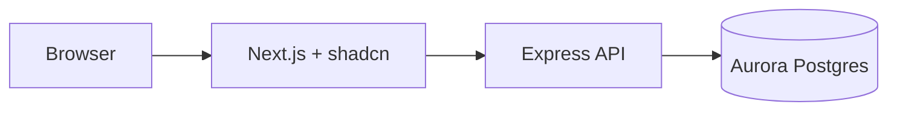

# RecipeGuru

A standalone full-stack recipe discovery app: browse recipes, view details (ingredients + photos), backed by an isolated PostgreSQL database.

> Status: early scaffolding. See [`spec-recipeguru.md`](./spec-recipeguru.md) for the authoritative product spec.

## Stack

| Layer            | Choice                                                                                                                                             |
| ---------------- | -------------------------------------------------------------------------------------------------------------------------------------------------- |
| Database         | Amazon Aurora PostgreSQL via the [Vercel Marketplace AWS integration](https://vercel.com/docs/integrations) — dedicated instance for this app only |
| Schema / queries | [Drizzle ORM](https://orm.drizzle.team/) with `drizzle-kit` for migrations (`generate`, `migrate`, optional `push` in dev)                         |
| API              | Node.js + Express, `pg` pool, `drizzle-orm/node-postgres`                                                                                          |
| Web              | Next.js (App Router), Tailwind CSS, shadcn/ui                                                                                                      |
| Runtime          | No Docker for the app runtime; optional local Postgres (Docker or native) for development, migrations, and seed data                               |

## Architecture



- The browser never holds DB credentials.
- Next.js calls Express via `fetch` using `NEXT_PUBLIC_API_URL`.
- Express owns all DB access to Aurora (IAM/OIDC pattern — see below).

## Repository layout

```text
recipeguru/
  apps/
    api/          # Express + pg + Drizzle + RDS IAM pool
    web/          # Next.js + Tailwind + shadcn
  docs/           # database + CLI guides
  spec-recipeguru.md
  README.md
```

> The `apps/` workspaces will be scaffolded as the vertical slice lands.

## Getting started

### Prerequisites

- Node.js 20+ and a package manager (pnpm, npm, or yarn)
- A PostgreSQL instance for development — either:
  - a provisioned Aurora cluster reachable via Vercel's AWS integration, or
  - a local Postgres (Docker or native) for schema work and seeding
- The [Vercel CLI](https://vercel.com/docs/cli) if you are wiring up Aurora + OIDC

### 1. Clone and install

```bash
git clone <this-repo>
cd recipeguru
# install deps in each app once they exist:
# (cd apps/api && npm install) && (cd apps/web && npm install)
```

### 2. Configure environment

Follow the authoritative guide: [Connect Next.js to Amazon Aurora PostgreSQL using Vercel Marketplace](https://vercel.com/kb/guide/connect-next-js-to-amazon-aurora-postgresql-using-vercel-marketplace).

In this repo the same pool + RDS IAM token logic lives in **Express** (not in Next Server Components). Drizzle is instantiated with that pool so all DB access goes through typed queries and checked-in migrations.

Pull Vercel-managed env into `apps/api/.env.local`:

```bash
cd apps/api
vercel link
vercel env pull
```

**`apps/api`** expects (per the KB article):

- `AWS_ROLE_ARN`, `AWS_REGION`
- `PGHOST`, `PGPORT`, `PGUSER`, `PGDATABASE`
- `VERCEL_OIDC_TOKEN` (when running on Vercel)
- `CORS_ORIGIN`, `PORT` (e.g. `4001` locally)

If Express runs **outside** Vercel, swap the OIDC/IAM wiring for a standard Postgres URL on that host.

**`apps/web`** expects:

- `NEXT_PUBLIC_API_URL` — public base URL of the Express API (e.g. `http://localhost:4001`)

Optional observability:

- Sentry DSNs (Next + Node SDKs)
- `NEXT_PUBLIC_POSTHOG_KEY` and PostHog host (web)

### 3. Database schema & migrations

Tables are defined as Drizzle schema modules in `apps/api`. Migrations are managed with `drizzle-kit` and committed to git.

```bash
cd apps/api
npx drizzle-kit generate   # create a new migration from schema changes
npx drizzle-kit migrate    # apply pending migrations
npx drizzle-kit studio     # optional: quick row browser
```

See [`docs/database-cli-guide-recipeguru.md`](./docs/database-cli-guide-recipeguru.md) and [`docs/database-cli-guide-shared.md`](./docs/database-cli-guide-shared.md) for project-specific DB commands.

### 4. Run locally

```bash
# terminal 1 — API
cd apps/api && npm run dev    # Express on http://localhost:4001

# terminal 2 — web
cd apps/web && npm run dev    # Next.js on http://localhost:3000
```

## Data model

PostgreSQL schema (database name: `recipeguru` or your chosen name) with at least:

- `recipes`
- `recipes_photos`
- `ingredients`
- `recipe_ingredients`

## API (target)

Routes are finalized in `apps/api`; these are the contracts the web app expects:

### Recipes

| Method | Path (suggested)      | Purpose                                                     |
| ------ | --------------------- | ----------------------------------------------------------- |
| GET    | `/api/recipes/search` | List recipes with `recipe_id`, `title`, poster `url`        |
| GET    | `/api/recipes/:id`    | Single recipe: `title`, `body`, `photos[]`, `ingredients[]` |

### Ingredients (backlog)

| Method | Path (suggested) | Purpose                                                   |
| ------ | ---------------- | --------------------------------------------------------- |
| GET    | by type          | All ingredients of a given type                           |
| GET    | search           | Paginated search — 5 rows per page, include `total_count` |

## Frontend

- Recipe grid/list, search, and recipe detail (ingredients + photos).
- Optional ingredient browser once the ingredients API exists.

## Deployment

- **Express on Vercel** — see [Express on Vercel](https://vercel.com/docs/frameworks/backend/express); default export `app`, no `express.static` for an API-only app.
- **Next on Vercel** — standard Next deployment; set `NEXT_PUBLIC_API_URL` to the deployed API URL.

## Supporting tooling (recommended)

| Concern                  | Suggestion                                                                 |
| ------------------------ | -------------------------------------------------------------------------- |
| Request / env validation | [Zod](https://zod.dev/) — validate query/body and `process.env` in the API |
| HTTP from Next to API    | Native `fetch` — no extra client for v1                                    |
| Quality                  | ESLint + Prettier (or Biome); TypeScript `strict`                          |
| Tests                    | Vitest for units; contract/e2e against API + DB as needed                  |
| CI                       | GitHub Actions — `lint`, `typecheck`, `test`, migrate on deploy            |

## Observability (recommended)

| Tool                            | Role                                                                                                                                      |
| ------------------------------- | ----------------------------------------------------------------------------------------------------------------------------------------- |
| [Sentry](https://sentry.io/)    | Errors and uncaught exceptions on Next and Express; release tracking                                                                      |
| [PostHog](https://posthog.com/) | Product analytics — funnels, feature flags; keep PII policy explicit                                                                      |
| Vercel                          | Built-in [Web Analytics](https://vercel.com/docs/analytics) and [Speed Insights](https://vercel.com/docs/speed-insights) for the Next app |
| `pino` / `pino-http`            | Structured JSON logs on Express                                                                                                           |
| Uptime ping (optional)          | External monitor on production API `health` and web URL                                                                                   |

Practical order: Sentry + structured logs first, then Vercel Analytics/Speed Insights, then PostHog.

## License

Use the license file at the repository root once added. Attribute third-party code per its own license when you vendor or copy it.
