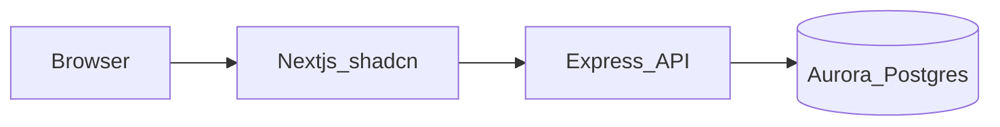

# RecipeGuru — product spec

A full-stack app for recipe discovery and detail, backed by PostgreSQL.

## Stack

| Layer            | Choice                                                                                                                                                                                 |
| ---------------- | -------------------------------------------------------------------------------------------------------------------------------------------------------------------------------------- |
| Database         | **Amazon Aurora PostgreSQL** via [Vercel Marketplace AWS integration](https://vercel.com/docs/integrations) — dedicated instance for this app only.                                    |
| Schema & queries | **[Drizzle ORM](https://orm.drizzle.team/)** — TypeScript table definitions, SQL-transparent queries, **`drizzle-kit`** for migrations (`generate`, `migrate`, optional `push` in dev) |
| API              | **Node.js + Express** — **`pg`** pool; Drizzle’s `drizzle-orm/node-postgres` (or `pg` driver)                                                                                          |
| Web              | **Next.js** (App Router), **Tailwind CSS**, **shadcn/ui**                                                                                                                              |
| Runtime          | **No Docker** for app runtime; optional **local Postgres** for development, migrations, and seed data                                                                                  |

## Architecture



- **Browser** never holds DB credentials. **Next** calls **Express** via `fetch` using `NEXT_PUBLIC_API_URL`.
- **Express** owns DB access to Aurora (IAM/OIDC pattern below), not the browser. THe DB pool + RDS IAM token logic lives in Express
- Instantiate Drizzle with that pool so all DB access goes through typed queries and migrations, not ad-hoc string SQL in route handlers (use sql templates for raw SQL).
- Local dev: vercel link and vercel env pull → .env.local with AWS_ROLE_ARN, AWS_REGION, PGHOST, PGPORT, PGUSER, PGDATABASE, VERCEL_OIDC_TOKEN, etc., as in the KB article.
- If Express runs outside Vercel, OIDC/IAM wiring differs — you may use a standard Postgres password/URL for that host; document the split in your README.

## Authentication

The app (Vercel Function) uses Vercel OIDC Federation to fetch AWS temporary credetials from AWS STS. Then it uses AWS cred to locally sign (using @aws-sdk/rds-signer) a password-shaped short-lived RDS auth token. Vercel Function uses this signed token as password to authenticate/connect with Aurora PostgreSQL. Aurora verifies signature via IAM (checks rds-db:connect permission). Connection established.

**Per-credential lifeline (e.g., roughly hourly, until temp creds expires)**
Vercel Function -OIDC token-> AWS STS

Vercel Function <-AWS temp credentials-- AWS STS

**Per DB connection (auth token cacheable ~15 min, so reused across many queries on a pooled connection — not regenerated per query)**
Vercel Function -RDS auth token-> Aurora PostgreSQL

Vercel Function <-Connection established- Aurora PostgreSQL

Vercel Function -query-> Aurora PostgreSQL

Vercel Function <-data- Aurora PostgreSQL

## Data model

RecipeGuru uses a PostgreSQL schema (database name can be **`recipeguru`** or your chosen name) with at least:

- `recipes`, `recipes_photos`, `ingredients`, `recipe_ingredients`

Define tables in **Drizzle** schema modules; generate and apply migrations with **`drizzle-kit`** (check migration SQL into git). Seed with Drizzle scripts, `psql`, or SQL fixtures. Use **`drizzle-kit studio`** locally if you want a quick row browser (optional).

## API routes

Implement in Express; paths below are illustrative — document the final routes in the README.

### Recipes

| Method | Suggested path                        | Purpose                                                     |
| ------ | ------------------------------------- | ----------------------------------------------------------- |
| GET    | `/api/recipes/search` (or equivalent) | List recipes with `recipe_id`, `title`, poster `url`        |
| GET    | `/api/recipes/:id` (or `?id=`)        | Single recipe: `title`, `body`, `photos[]`, `ingredients[]` |

### Ingredients (backlog)

| Method | Suggested path         | Purpose                                                                       |
| ------ | ---------------------- | ----------------------------------------------------------------------------- |
| GET    | by type                | All ingredients of a given type                                               |
| GET    | search with pagination | Search; paginate **5** rows per page; include **total_count** for all matches |

## Environment variables

**`apps/api` (Express on Vercel path)**
Variables from the KB guide for Aurora + IAM;
`CORS_ORIGIN`, `PORT` as needed (e.g. `4001` locally)

**`apps/web` (Next.js)**
`NEXT_PUBLIC_API_URL`— public base URL of the Express API (e.g.`http://localhost:4001`)

**Optional (observability)**

- Sentry: DSN env vars per Sentry’s Next + Node SDK docs (server vs client keys).
- PostHog: `NEXT_PUBLIC_POSTHOG_KEY` / host (web); use server-side key only if you capture events from Express.

## Application structure

```text
recipeguru/
  apps/
    api/          # Express + pg + Drizzle + RDS IAM pool
    web/          # Next.js + Tailwind + shadcn
  spec-recipeguru.md   # optional copy of this file at repo root
  README.md
```

## Frontend (Next.js)

- Recipe grid/list, search, recipe detail (ingredients + photos).
- Optional: ingredient browser once the ingredients API exists.

## Deployment notes

- **Express on Vercel:** [Express on Vercel](https://vercel.com/docs/frameworks/backend/express) — default export `app`; `express.static` is not used for API-only apps.
- **Next on Vercel:** standard Next deployment; set `NEXT_PUBLIC_API_URL` to the deployed API URL.

## License

Use the license file at the repository root for this project. Attribute third-party code per its own license when you vendor or copy it.
