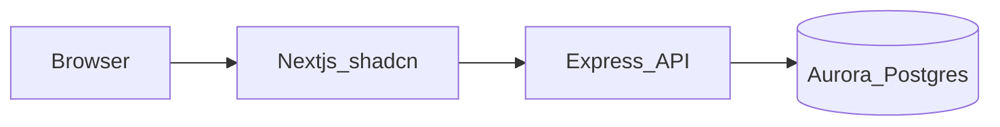

# RecipeGuru — product spec

Standalone full-stack app: recipe discovery and detail, backed by PostgreSQL.

## Stack (target)

| Layer | Choice |
|-------|--------|
| Database | **Amazon Aurora PostgreSQL** via [Vercel Marketplace AWS integration](https://vercel.com/docs/integrations) — dedicated instance for this app only |
| Schema & queries | **[Drizzle ORM](https://orm.drizzle.team/)** — TypeScript table definitions, SQL-transparent queries, **`drizzle-kit`** for migrations (`generate`, `migrate`, optional `push` in dev) |
| API | **Node.js + Express** — **`pg`** pool (same as Aurora IAM guide); Drizzle’s `drizzle-orm/node-postgres` (or `pg` driver) |
| Web | **Next.js** (App Router), **Tailwind CSS**, **shadcn/ui** |
| Runtime | **No Docker** for app runtime; optional **local Postgres** (Docker or native) for development, migrations, and seed data |

## Architecture



- **Browser** never holds DB credentials. **Next** calls **Express** via `fetch` using `NEXT_PUBLIC_API_URL`.
- **Express** owns DB access to Aurora (IAM/OIDC pattern below), not the browser.

## Aurora + Vercel (authoritative guide)

Follow: [Connect Next.js to Amazon Aurora PostgreSQL using Vercel Marketplace](https://vercel.com/kb/guide/connect-next-js-to-amazon-aurora-postgresql-using-vercel-marketplace)

That guide uses **`pg`**, **`@aws-sdk/rds-signer`**, **`@vercel/functions`** (`awsCredentialsProvider` from OIDC, **`attachDatabasePool`** for serverless pooling). The example queries from **Next Server Components**; in **this** architecture, put the same pool + RDS IAM token logic in **Express** when the API runs **on Vercel**. Instantiate **Drizzle** with that pool so all DB access goes through typed queries and migrations, not ad-hoc string SQL in route handlers (use `sql` templates when you need raw SQL).

- Local dev: `vercel link` and `vercel env pull` → `.env.local` with `AWS_ROLE_ARN`, `AWS_REGION`, `PGHOST`, `PGPORT`, `PGUSER`, `PGDATABASE`, `VERCEL_OIDC_TOKEN`, etc., as in the KB article.
- If Express runs **outside** Vercel, OIDC/IAM wiring differs — you may use a standard Postgres password/URL for that host; document the split in your README.

## Environment variables

**`apps/api` (Express on Vercel path)**

- Variables from the KB guide for Aurora + IAM
- `CORS_ORIGIN`, `PORT` as needed (e.g. `4001` locally)

**`apps/web` (Next.js)**

- `NEXT_PUBLIC_API_URL` — public base URL of the Express API (e.g. `http://localhost:4001`)

**Optional (observability)**

- Sentry: DSN env vars per Sentry’s Next + Node SDK docs (server vs client keys).
- PostHog: `NEXT_PUBLIC_POSTHOG_KEY` / host (web); use server-side key only if you capture events from Express.

## Suggested repo layout

```text
recipeguru/
  apps/
    api/          # Express + pg + Drizzle + RDS IAM pool
    web/          # Next.js + Tailwind + shadcn
  spec-recipeguru.md   # optional copy of this file at repo root
  README.md
```

## Data model

RecipeGuru uses a PostgreSQL schema (database name can be **`recipeguru`** or your chosen name) with at least:

- `recipes`, `recipes_photos`, `ingredients`, `recipe_ingredients`

Define tables in **Drizzle** schema modules; generate and apply migrations with **`drizzle-kit`** (check migration SQL into git). Seed with Drizzle scripts, `psql`, or SQL fixtures. Use **`drizzle-kit studio`** locally if you want a quick row browser (optional).

## Supporting stack (recommended)

| Concern | Suggestion |
|---------|------------|
| Request / env validation | **Zod** — parse query/body and `process.env` in the API; share types with the web app where useful |
| HTTP from Next to API | **`fetch`** (native) — no extra client required for v1 |
| Quality | **ESLint** + **Prettier** (or **Biome**); **TypeScript** `strict` |
| Tests (when you add them) | **Vitest** for units; contract or e2e against API + DB as needed |
| CI | **GitHub Actions** (or your host’s default) — `lint`, `typecheck`, `test`, migrate on deploy |

Nothing above is mandatory for a first vertical slice; add as soon as routes and env surface grow.

## Observability & analytics (recommended)

| Tool | Role |
|------|------|
| **[Sentry](https://sentry.io/)** | Errors and uncaught exceptions on **Next** and **Express**; optional performance traces / profiling; release tracking for regressions |
| **[PostHog](https://posthog.com/)** (or similar) | Product analytics — page views, funnels, feature flags later; keep PII policy explicit if you add auth |
| **Vercel** | Built-in **[Web Analytics](https://vercel.com/docs/analytics)** and **[Speed Insights](https://vercel.com/docs/speed-insights)** for the Next app (traffic and Core Web Vitals) — complements or replaces some PostHog usage for web vitals |
| **Structured logs** | **pino** (or **pino-http** on Express) with JSON logs; on Vercel, logs go to the deployment log stream — enough for v1 debugging |
| **Uptime** (optional) | External ping (e.g. Better Stack, UptimeRobot) on production **API** `health` and **web** URL |

**Practical order:** Sentry + structured logging first (you will see failures immediately), then Vercel Analytics/Speed Insights if the app is on Vercel, then PostHog when you care about funnels and behavior beyond basics.

## API behavior (target)

Implement in Express; paths below are illustrative — document the final routes in the README.

### Recipes

| Method | Suggested path | Purpose |
|--------|----------------|---------|
| GET | `/api/recipes/search` (or equivalent) | List recipes with `recipe_id`, `title`, poster `url` |
| GET | `/api/recipes/:id` (or `?id=`) | Single recipe: `title`, `body`, `photos[]`, `ingredients[]` |

### Ingredients (backlog)

| Method | Suggested path | Purpose |
|--------|----------------|---------|
| GET | by type | All ingredients of a given type |
| GET | search with pagination | Search; paginate **5** rows per page; include **total_count** for all matches |

## Frontend (Next.js)

- Recipe grid/list, search, recipe detail (ingredients + photos).
- Optional: ingredient browser once the ingredients API exists.

## Deployment notes

- **Express on Vercel:** [Express on Vercel](https://vercel.com/docs/frameworks/backend/express) — default export `app`; `express.static` is not used for API-only apps.
- **Next on Vercel:** standard Next deployment; set `NEXT_PUBLIC_API_URL` to the deployed API URL.
- Alternative: host Express on Railway, Render, Fly, etc.; document how Aurora auth works (or doesn’t) on that host.

## Non-goals (v1)

- User auth (unless you add it as stretch)
- Mixing this DB with the ReelingIt / **`omdb`** dataset or its Supabase project — **isolated** Aurora for RecipeGuru only

## License

Use the license file at the repository root for this project. Attribute third-party code per its own license when you vendor or copy it.
